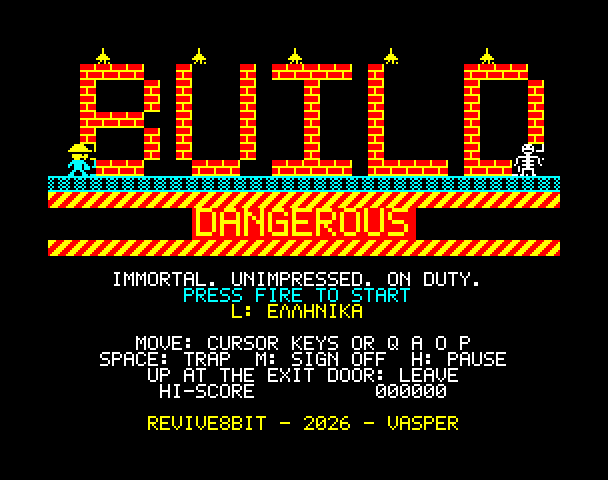
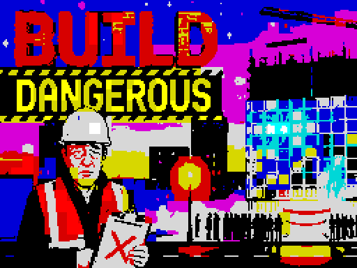
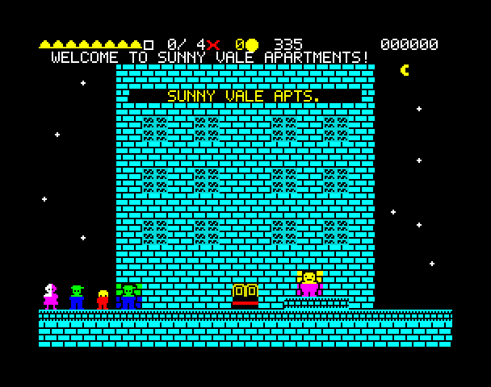
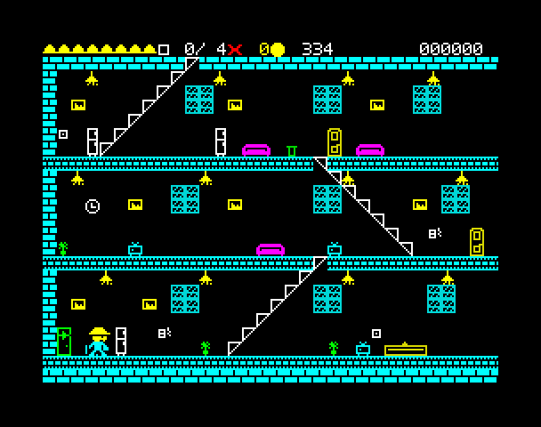
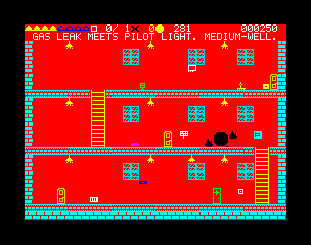
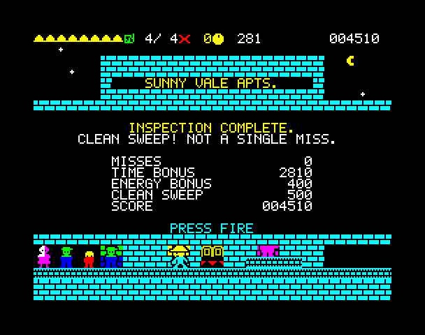
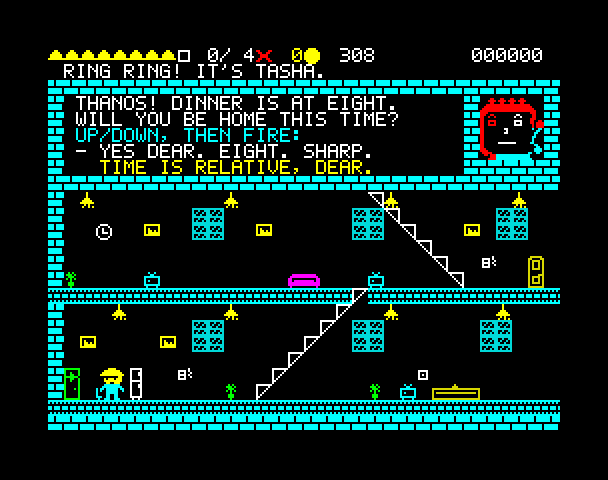
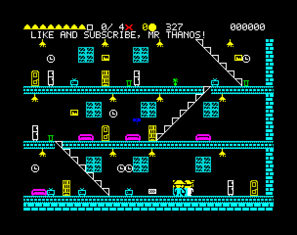
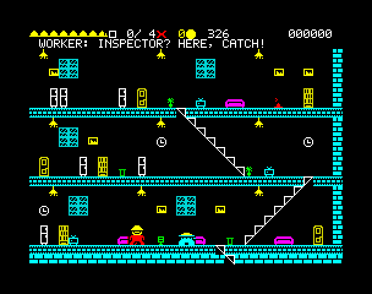
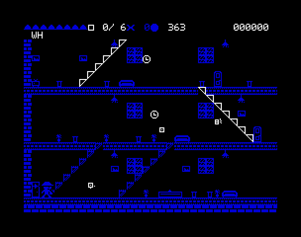

# Build Dangerous — Manual

*ZX Spectrum 48K / 128K / +2. REVIVE8BIT – 2026 – VASPER.*

## The story

Thanos is a building inspector. He is also immortal, which is the only reason he still has the job.

Every building in town is about to open, and every owner has the same plan: cut the ribbon, let the crowd in, and hope nobody finds the live wires, the hungry guard ferret and the "NOT A COMPACTOR" room before the insurance runs out. Thanos's job is to find every trap first. Since nothing can kill him, the quickest way to make a trap safe is to walk up to it and set it off. Then he signs the room off and moves on, while the crowd outside gets more impatient by the second.

He is immortal. Unimpressed. On duty.

## Loading

**Spectrum 48K**: rewind the tape and type

    LOAD ""

(**J**, then **SYMBOL SHIFT** + **P** twice), press **ENTER** and then **PLAY**.

**Spectrum 128K / +2**: choose **Tape Loader** from the menu and press **PLAY**.

The loading picture comes in first, then the game, which starts on its own. Loading takes about four minutes. The game is the same on every model. A 128K plays the sound on its sound chip; a 48K plays it on the beeper.

**Emulators**: load `bd.tap` or `bd.tzx` the same way, or open the snapshot `bd48.z80` or `bd128.z80` to start at once.

## The title screen

| Key | |
|---|---|
| **SPACE** / Fire | Start the game |
| **L** | Switch between English and Greek (Ελληνικά) |

The language applies to everything: the captions, the dialogue and the results.

## Controls

| Action | Keyboard | Kempston joystick |
|---|---|---|
| Walk left / right | O / P or the cursor keys ← → | Left / Right |
| Climb stairs (at the foot / top of a flight) | Q / A or ↑ / ↓ | Up / Down |
| Jump (on a floor) | Q or ↑, with left / right to steer | Up |
| Duck (on a floor, hold) | A or ↓ | Down |
| Set off a trap (stand next to it) | SPACE (or ENTER, or 0) | Fire |
| Sign off the room | M | Fire 2 |
| Leave the building (at the exit door) | Q or ↑ | Up |
| Answer the phone | Up / down to choose, SPACE to answer | Up / Down, Fire |
| Pause | H | Fire 1 + Fire 2 together |
| Skip a scene / continue | SPACE | Fire |

The cursor keys are CAPS SHIFT + 5, 6, 7, 8; the keys 5 to 8 alone work too, so a cursor (Protek) joystick works with 0 as fire. Most Kempston joysticks have one button: use **M** to sign off.

Once you are on a flight of stairs, left and right follow it up or down. Escalators (in the mall and the hospital) carry you on their own: step on and enjoy the ride. The green ones go up and the red ones go down; you can't walk up a down escalator.

## How to play

Each building starts outside. The owner makes a speech, the crowd waits behind the ribbon, and Thanos walks in. From then on the clock is running.

### The screen

Along the top of the screen, from left to right:

- **Hard hats**: Thanos's energy (his reputation, really). Eight hats; a hat can be half gone.
- **Box and rooms**: the box is ticked when the room you are in has been signed off; next to it, how many rooms are signed off out of the building's total.
- **× and a number**: Misses so far in this building.
- **Clock**: the crowd's patience, in seconds.
- **Score**.

Messages and captions appear on the line just below, typed over the top of the room.

### Finding traps

Every trap shows a small **tell**: a socket with a bare wire, a lamp hanging by a frayed cord, a dripping valve, eyes behind a grille, a cushion with something sharp in it, a gas pilot light, a freezer with a cracked handle, a leaking drum, a vent with no grille, a frayed lift cable, a door sensor throwing sparks, a sign that says "NOT A COMPACTOR".

Stand next to it and press **SPACE**. Thanos sets it off on purpose and lives through it, as always. That takes a few seconds, and the clock keeps running. The trap is then safe for good (+50 points).

The first three times you are within reach of a trap, a window tells you so: *You are in front of a trap. Press SPACE to activate it.* After the third, you're on your own — almost: whenever a trap is within reach, Thanos's sixth sense puts a blinking **?** over his head. And when you have set off every trap in a room, a window reminds you to sign it off with **M** — until the first time you do.

Not everything that looks dangerous is: some sockets are perfectly safe, and some buildings have decoys. Pressing SPACE next to a safe one does nothing. Look closely at the tell.

### Signing off rooms

When a room is clear, press **M** to sign it off (+100 points). The box at the top is ticked.

If you sign off a room that still has a live trap, that's a **Miss**: the border flashes magenta, you lose **two hard hats** and 200 points, and the Miss goes on your record. The crowd will find that trap before you do.

### Leaving

The building's exit door is in the room where you came in. When **every room** is signed off, stand in front of the door and press **↑**. If rooms are still unchecked, Thanos won't leave.

### How a building ends

- **You leave in time**: the ribbon is cut and the crowd cheers. You get the results and move on to the next building. The fewer Misses, the better the grade: a *Clean sweep* (no Misses), *A few misses* or *Passed. Barely.*
- **Time runs out with at least half the rooms signed off**: the owner delays the opening. Not great, but you go on to the next building — unless it was the last one, where it ends the game.
- **Time runs out with fewer than half signed off**: the ribbon is cut anyway and the crowd goes in. Game over.
- **You run out of hard hats**: your contract is terminated. Game over.

Between buildings Thanos gets back three hard hats.

## Things that get in the way

### Tasha phones

Thanos's wife, Tasha, phones two or three times in every inspection, at random moments after the first twenty seconds. Her face appears in a window at the top of the screen and Thanos stops to talk. She asks; you pick the answer with **↑ / ↓** and say it with **SPACE**.

The right answer ends the call quickly (+50 points). The wrong answer, or saying nothing, makes it drag on — and Tasha has plenty more to say.

### Bambis, the owner's nephew

Bambis is an influencer, and he is everywhere. He paces up and down a floor with his phone out. If he catches Thanos, he takes a selfie, with two flashes and a caption, while the clock runs. A few seconds later he wants another.

**Jump over him.** He can't get his selfie while Thanos is in the air.

### Last-minute workers

The builders haven't quite finished, and they are not pleased to see the inspector. A worker paces his floor. When Thanos is on the same floor, he stops, raises a tool — that's your warning — and throws it:

- **Hammers**, and some **wrenches**, fly at head height: **duck** (hold ↓).
- **Nails** from the nail gun, and other wrenches, fly at foot height, and fast: **jump** (↑).

A jump clears either kind. A hit costs **half a hard hat**, flashes the border red and leaves Thanos dizzy for a moment. After a throw, a worker rests for about ten seconds before the next.

### The owner

From the Mall on, the owner himself walks some of the rooms. He has his reasons for wanting the traps to stay. If he passes a trap you've made safe in a room you **haven't signed off yet**, he sets it again: *"That was decorative!"* He won't do it in front of the inspector, though — while Thanos is close by, he just walks past. So sign each room off as soon as it's clear.

### Blackouts

The owner of every building after the first hasn't paid the electricity bill. Every 40 to 60 seconds the lights go out for five seconds. Everything turns dark blue, and only the white things still show: the stairs, the fridges, the sockets, the words. The workers keep throwing in the dark.

## The buildings

1. **Sunny Vale Apartments** — four rooms, a gentle start.
2. **Big Box Mall** — six rooms, escalators, the food court.
3. **Grand Hotel** — six rooms, a grand staircase, the suites.
4. **Mega Hospital** — six rooms, escalators, and decoys.
5. **Hard Knock Hotel & Casino** — six rooms of neon: slot machines, a stage, a rooftop pool.
6. **The Skyscraper** — eight rooms, the owner's own tower. Something is hidden under the boardroom stairs…

Finish the Skyscraper and the campaign is over. How it ends depends on whether Thanos found the owner's papers.

## Scoring

| | Points |
|---|---|
| Trap set off and made safe | 50 |
| Room signed off | 100 |
| Phone call answered right | 50 |
| The owner's papers | 500 |
| Miss | −200 |
| **When you leave a building in time:** | |
| Time bonus | 10 per second left |
| Energy bonus | 25 per half hat left |
| Clean sweep (no Misses) | 500 |

The best score of the session is shown on the title screen.

## Tips

- Plan your route. Every trap costs time, and so does walking back.
- Sign off each room as soon as it is clear. It's easy to forget one on the far side of the building.
- When a worker raises his tool, decide quickly: duck for the high ones, jump for the low ones. Or leave his floor.
- Answer Tasha well. It's quicker, and it's better for the marriage.
- If the clock is running out, make sure at least half the rooms are signed off.
- When the lights go out, stand still or walk along a floor you know. They're back in five seconds.

## Credits

**Build Dangerous** — REVIVE8BIT – 2026 – VASPER.
