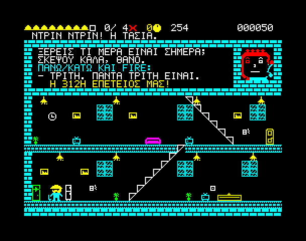

# Build Dangerous — Εγχειρίδιο

*ZX Spectrum 48K / 128K / +2. REVIVE8BIT – 2026 – VASPER.*

## Η ιστορία

Ο Θάνος είναι επιθεωρητής κτιρίων. Είναι επίσης αθάνατος, και μόνο γι' αυτό κρατάει ακόμα τη δουλειά του.

Όλα τα κτίρια της πόλης ετοιμάζονται για εγκαίνια, και όλοι οι ιδιοκτήτες έχουν το ίδιο σχέδιο: να κοπεί η κορδέλα, να μπει ο κόσμος, και κανείς να μη βρει τα γυμνά καλώδια, το πεινασμένο κουνάβι-φύλακα και το δωμάτιο «ΔΕΝ ΕΙΝΑΙ ΣΥΜΠΙΕΣΤΗΣ» πριν λήξει η ασφάλεια. Η δουλειά του Θάνου είναι να βρει πρώτος κάθε παγίδα. Αφού τίποτα δεν μπορεί να τον σκοτώσει, ο πιο γρήγορος τρόπος να γίνει μια παγίδα ακίνδυνη είναι να πάει δίπλα της και να την ενεργοποιήσει. Μετά υπογράφει το δωμάτιο και προχωράει, ενώ ο κόσμος απέξω χάνει την υπομονή του δευτερόλεπτο με το δευτερόλεπτο.

Αθάνατος. Ασυγκίνητος. Σε υπηρεσία.

## Φόρτωση

**Spectrum 48K**: γυρίστε την κασέτα στην αρχή και γράψτε

    LOAD ""

(**J**, και μετά δύο φορές **SYMBOL SHIFT** + **P**), πατήστε **ENTER** και μετά **PLAY**.

**Spectrum 128K / +2**: διαλέξτε **Tape Loader** από το μενού και πατήστε **PLAY**.

Πρώτα φορτώνει η εικόνα φόρτωσης και μετά το παιχνίδι, που ξεκινάει μόνο του. Η φόρτωση διαρκεί περίπου τέσσερα λεπτά. Το παιχνίδι είναι ίδιο σε όλα τα μοντέλα. Ο 128K παίζει τον ήχο από το ηχητικό του chip, ο 48K από το beeper.

**Emulators**: φορτώστε το `bd.tap` ή το `bd.tzx` με τον ίδιο τρόπο, ή ανοίξτε το snapshot `bd48.z80` ή `bd128.z80` για να ξεκινήσει αμέσως.

## Η οθόνη τίτλου

| Πλήκτρο | |
|---|---|
| **SPACE** / Fire | Ξεκινάει το παιχνίδι |
| **L** | Αλλάζει γλώσσα: Ελληνικά ή English |

Η γλώσσα ισχύει για όλα: λεζάντες, διαλόγους και αποτελέσματα.

## Χειρισμός

| Ενέργεια | Πληκτρολόγιο | Joystick Kempston |
|---|---|---|
| Περπάτημα αριστερά / δεξιά | O / P ή τα βελάκια ← → | Αριστερά / Δεξιά |
| Σκάλες (στη βάση / στην κορυφή τους) | Q / A ή ↑ / ↓ | Πάνω / Κάτω |
| Άλμα (πάνω σε πάτωμα) | Q ή ↑, με αριστερά / δεξιά για κατεύθυνση | Πάνω |
| Σκύψιμο (πάνω σε πάτωμα, κρατημένο) | A ή ↓ | Κάτω |
| Ενεργοποίηση παγίδας (δίπλα της) | SPACE (ή ENTER, ή 0) | Fire |
| Υπογραφή δωματίου | M | Fire 2 |
| Αποχώρηση (στην πόρτα εξόδου) | Q ή ↑ | Πάνω |
| Απάντηση στο τηλέφωνο | Πάνω / κάτω για επιλογή, SPACE για απάντηση | Πάνω / Κάτω, Fire |
| Παύση | H | Fire 1 + Fire 2 μαζί |
| Προσπέραση σκηνής / συνέχεια | SPACE | Fire |

Τα βελάκια είναι CAPS SHIFT + 5, 6, 7, 8. Δουλεύουν και τα 5 έως 8 σκέτα, άρα και ένα cursor (Protek) joystick, με το 0 για fire. Τα περισσότερα joystick Kempston έχουν ένα κουμπί: για την υπογραφή χρησιμοποιήστε το **M**.

Όταν είστε πάνω σε σκάλα, το αριστερά και το δεξιά την ακολουθούν προς τα πάνω ή προς τα κάτω. Οι κυλιόμενες σκάλες (στο εμπορικό και στο νοσοκομείο) σας μεταφέρουν μόνες τους: ανεβείτε και απολαύστε τη διαδρομή. Οι πράσινες ανεβαίνουν και οι κόκκινες κατεβαίνουν· δεν μπορείτε να ανεβείτε από κυλιόμενη σκάλα που κατεβαίνει.

## Πώς παίζεται

Κάθε κτίριο ξεκινάει απέξω. Ο ιδιοκτήτης βγάζει λόγο, ο κόσμος περιμένει πίσω από την κορδέλα και ο Θάνος μπαίνει μέσα. Από εκεί και πέρα το ρολόι μετράει.

### Η οθόνη

Στο πάνω μέρος της οθόνης, από αριστερά προς τα δεξιά:

- **Κράνη**: η ενέργεια του Θάνου (στην ουσία η φήμη του). Οκτώ κράνη· ένα κράνος μπορεί να έχει μείνει μισό.
- **Κουτάκι και δωμάτια**: το κουτάκι τσεκάρεται όταν το δωμάτιο όπου βρίσκεστε έχει υπογραφεί· δίπλα, πόσα δωμάτια έχουν υπογραφεί από το σύνολο του κτιρίου.
- **× και ένας αριθμός**: οι Αστοχίες μέχρι τώρα σε αυτό το κτίριο.
- **Ρολόι**: η υπομονή του κόσμου, σε δευτερόλεπτα.
- **Βαθμολογία**.

Τα μηνύματα και οι λεζάντες εμφανίζονται στη γραμμή ακριβώς από κάτω, πάνω από το ταβάνι του δωματίου.

### Πώς βρίσκετε τις παγίδες

Κάθε παγίδα έχει ένα μικρό **σημάδι**: πρίζα με γυμνό καλώδιο, λάμπα κρεμασμένη από ξεφτισμένο καλώδιο, βρύση που στάζει, μάτια πίσω από σχάρα, μαξιλάρι με κάτι μυτερό μέσα, φλογίτσα γκαζιού, καταψύκτης με σπασμένο χερούλι, βαρέλι που τρέχει, αεραγωγός χωρίς σχάρα, ξεφτισμένο συρματόσχοινο, αισθητήρας πόρτας που βγάζει σπίθες, πινακίδα «ΔΕΝ ΕΙΝΑΙ ΣΥΜΠΙΕΣΤΗΣ».

Σταθείτε δίπλα της και πατήστε **SPACE**. Ο Θάνος την ενεργοποιεί επίτηδες και, όπως πάντα, επιβιώνει. Αυτό κρατάει λίγα δευτερόλεπτα, και το ρολόι συνεχίζει να μετράει. Μετά η παγίδα είναι ακίνδυνη για πάντα (+50 πόντοι).

Τις τρεις πρώτες φορές που βρίσκεστε κοντά σε παγίδα, ένα παράθυρο σας το λέει: *Είσαι μπροστά σε μια παγίδα. Πάτα SPACE για να την ενεργοποιήσεις.* Μετά την τρίτη, είστε μόνοι σας — σχεδόν: όποτε μια παγίδα είναι σε απόσταση, η έκτη αίσθηση του Θάνου βάζει ένα **?** που αναβοσβήνει πάνω από το κεφάλι του. Κι όταν έχετε ενεργοποιήσει όλες τις παγίδες ενός δωματίου, ένα παράθυρο σας θυμίζει να το σημειώσετε ως ελεγμένο με το **M** — ώσπου να το κάνετε για πρώτη φορά.

Δεν είναι επικίνδυνο ό,τι μοιάζει επικίνδυνο: κάποιες πρίζες είναι εντελώς ασφαλείς, και μερικά κτίρια έχουν δολώματα. Αν πατήσετε SPACE δίπλα σε κάτι ακίνδυνο, δεν γίνεται τίποτα. Κοιτάξτε προσεκτικά το σημάδι.

### Υπογραφή δωματίων

Όταν ένα δωμάτιο είναι καθαρό, πατήστε **M** για να το υπογράψετε (+100 πόντοι). Το κουτάκι πάνω τσεκάρεται.

Αν υπογράψετε δωμάτιο που έχει ακόμα ενεργή παγίδα, είναι **Αστοχία**: το περίγραμμα αναβοσβήνει μοβ, χάνετε **δύο κράνη** και 200 πόντους, και η Αστοχία γράφεται στο μητρώο σας. Ο κόσμος θα βρει αυτή την παγίδα πριν από εσάς.

### Αποχώρηση

Η πόρτα εξόδου του κτιρίου είναι στο δωμάτιο από όπου μπήκατε. Όταν έχουν υπογραφεί **όλα** τα δωμάτια, σταθείτε μπροστά στην πόρτα και πατήστε **↑**. Αν υπάρχουν ανέλεγκτα δωμάτια, ο Θάνος δεν φεύγει.

### Πώς τελειώνει ένα κτίριο

- **Φεύγετε στην ώρα σας**: η κορδέλα κόβεται και ο κόσμος ζητωκραυγάζει. Βλέπετε τα αποτελέσματα και πάτε στο επόμενο κτίριο. Όσο λιγότερες Αστοχίες, τόσο καλύτερος ο χαρακτηρισμός: *Καθαρή δουλειά* (καμία Αστοχία), *Λίγες αστοχίες* ή *Πέρασε. Με το ζόρι.*
- **Τελειώνει ο χρόνος με τα μισά τουλάχιστον δωμάτια υπογεγραμμένα**: ο ιδιοκτήτης αναβάλλει τα εγκαίνια. Όχι καλό, αλλά συνεχίζετε στο επόμενο κτίριο — εκτός αν ήταν το τελευταίο, οπότε το παιχνίδι τελειώνει.
- **Τελειώνει ο χρόνος με λιγότερα από τα μισά υπογεγραμμένα**: η κορδέλα κόβεται έτσι κι αλλιώς και ο κόσμος μπαίνει. Τέλος παιχνιδιού.
- **Τελειώνουν τα κράνη**: η σύμβασή σας καταγγέλλεται. Τέλος παιχνιδιού.

Ανάμεσα στα κτίρια ο Θάνος παίρνει πίσω τρία κράνη.

## Εμπόδια

### Τηλεφωνεί η Τασία

Η γυναίκα του Θάνου, η Τασία, τηλεφωνεί δύο ή τρεις φορές σε κάθε επιθεώρηση, σε τυχαίες στιγμές μετά τα πρώτα είκοσι δευτερόλεπτα. Το πρόσωπό της εμφανίζεται σε ένα παράθυρο στο πάνω μέρος της οθόνης και ο Θάνος σταματάει να της μιλήσει. Εκείνη ρωτάει· εσείς διαλέγετε απάντηση με **↑ / ↓** και την λέτε με **SPACE**.

Η σωστή απάντηση κλείνει γρήγορα το τηλέφωνο (+50 πόντοι). Η λάθος απάντηση, ή η σιωπή, το τραβάει σε μάκρος — και η Τασία έχει πολλά ακόμα να πει.

### Ο Μπάμπης, ο ανιψιός του ιδιοκτήτη

Ο Μπάμπης είναι influencer, και είναι παντού. Πηγαινοέρχεται σε έναν όροφο με το κινητό στο χέρι. Αν πετύχει τον Θάνο, βγάζει σέλφι, με δύο φλας και λεζάντα, ενώ το ρολόι τρέχει. Λίγα δευτερόλεπτα αργότερα θέλει κι άλλη.

**Πηδήξτε από πάνω του.** Δεν μπορεί να βγάλει σέλφι όσο ο Θάνος είναι στον αέρα.

### Εργάτες της τελευταίας στιγμής

Οι μάστορες δεν έχουν τελειώσει ακόμα, και δεν χαίρονται καθόλου που βλέπουν τον επιθεωρητή. Ένας εργάτης πηγαινοέρχεται στον όροφό του. Όταν ο Θάνος είναι στον ίδιο όροφο, σταματάει, σηκώνει ένα εργαλείο — αυτή είναι η προειδοποίηση — και το πετάει:

- Τα **σφυριά**, και μερικά **γαλλικά κλειδιά**, πετάνε στο ύψος του κεφαλιού: **σκύψτε** (κρατήστε ↓).
- Τα **καρφιά** από το καρφωτικό, και άλλα γαλλικά κλειδιά, πετάνε στο ύψος των ποδιών, και γρήγορα: **πηδήξτε** (↑).

Με άλμα τα αποφεύγετε όλα. Ένα χτύπημα κοστίζει **μισό κράνος**, κοκκινίζει το περίγραμμα και ζαλίζει τον Θάνο για λίγο. Μετά από κάθε ρίψη, ο εργάτης ξεκουράζεται περίπου δέκα δευτερόλεπτα πριν την επόμενη.

### Ο ιδιοκτήτης

Από το Εμπορικό Κέντρο και μετά, ο ίδιος ο ιδιοκτήτης κυκλοφορεί σε μερικά δωμάτια. Έχει τους λόγους του να θέλει τις παγίδες στη θέση τους. Αν περάσει από παγίδα που έχετε εξουδετερώσει, σε δωμάτιο που **δεν έχετε υπογράψει ακόμα**, την ξαναστήνει: *«Ήταν διακοσμητικό!»* Μπροστά στον επιθεωρητή όμως δεν τολμάει — όσο ο Θάνος είναι κοντά, απλώς προσπερνάει. Γι' αυτό υπογράφετε κάθε δωμάτιο μόλις καθαρίσει.

### Μπλακάουτ

Ο ιδιοκτήτης κάθε κτιρίου μετά το πρώτο δεν έχει πληρώσει το ρεύμα. Κάθε 40 με 60 δευτερόλεπτα τα φώτα σβήνουν για πέντε δευτερόλεπτα. Όλα γίνονται σκούρα μπλε και φαίνονται μόνο τα λευκά: οι σκάλες, τα ψυγεία, οι πρίζες, τα γράμματα. Οι εργάτες συνεχίζουν να πετάνε πράγματα στο σκοτάδι.

## Τα κτίρια

1. **Πολυκατοικία Λιακάδα** — τέσσερα δωμάτια, ένα ήπιο ξεκίνημα.
2. **Εμπορικό Κέντρο** — έξι δωμάτια, κυλιόμενες σκάλες, η πλατεία φαγητού.
3. **Ξενοδοχείο Γκραντ** — έξι δωμάτια, μια μεγαλοπρεπής σκάλα, οι σουίτες.
4. **Μέγα Νοσοκομείο** — έξι δωμάτια, κυλιόμενες σκάλες και δολώματα.
5. **Ξενοδοχείο & Καζίνο Hard Knock** — έξι δωμάτια με νέον: φρουτάκια, σκηνή, πισίνα στην ταράτσα.
6. **Ο Ουρανοξύστης** — οκτώ δωμάτια, ο πύργος του ίδιου του ιδιοκτήτη. Κάτι κρύβεται κάτω από τη σκάλα της αίθουσας συσκέψεων…

Με τον Ουρανοξύστη τελειώνει η περιπέτεια. Το τέλος αλλάζει ανάλογα με το αν ο Θάνος βρήκε τα χαρτιά του ιδιοκτήτη.

## Βαθμολογία

| | Πόντοι |
|---|---|
| Παγίδα που ενεργοποιήθηκε και έγινε ακίνδυνη | 50 |
| Υπογραφή δωματίου | 100 |
| Σωστή απάντηση στο τηλέφωνο | 50 |
| Τα χαρτιά του ιδιοκτήτη | 500 |
| Αστοχία | −200 |
| **Όταν φεύγετε στην ώρα σας:** | |
| Μπόνους χρόνου | 10 για κάθε δευτερόλεπτο που περίσσεψε |
| Μπόνους ενέργειας | 25 για κάθε μισό κράνος που έμεινε |
| Καθαρή δουλειά (καμία Αστοχία) | 500 |

Η καλύτερη βαθμολογία της συνεδρίας φαίνεται στην οθόνη τίτλου.

## Συμβουλές

- Σχεδιάστε τη διαδρομή σας. Κάθε παγίδα κοστίζει χρόνο, το ίδιο και το πήγαινε-έλα.
- Υπογράψτε κάθε δωμάτιο μόλις καθαρίσει. Είναι εύκολο να ξεχάσετε κάποιο στην άλλη άκρη του κτιρίου.
- Όταν ένας εργάτης σηκώνει το εργαλείο, αποφασίστε γρήγορα: σκύψτε για τα ψηλά, πηδήξτε για τα χαμηλά. Ή φύγετε από τον όροφό του.
- Απαντάτε σωστά στην Τασία. Είναι πιο γρήγορο, και καλύτερο για τον γάμο.
- Αν ο χρόνος τελειώνει, φροντίστε να έχετε υπογράψει τουλάχιστον τα μισά δωμάτια.
- Όταν σβήσουν τα φώτα, μείνετε ακίνητοι ή περπατήστε σε όροφο που ξέρετε. Σε πέντε δευτερόλεπτα ανάβουν ξανά.

## Συντελεστές

**Build Dangerous** — REVIVE8BIT – 2026 – VASPER.
